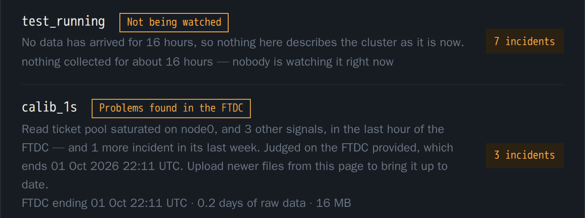
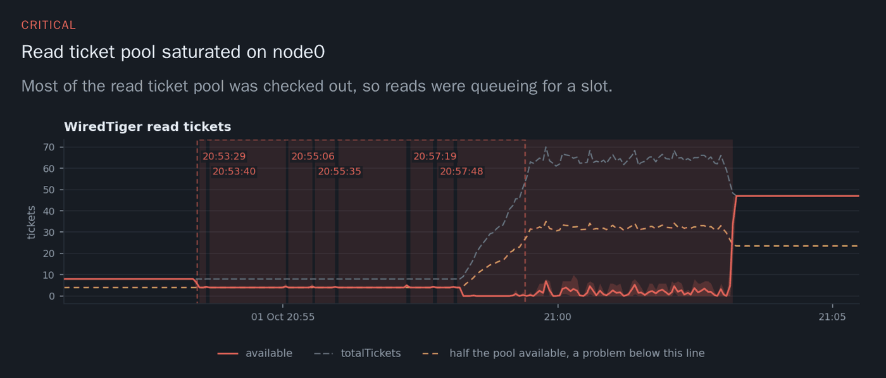

# mongo-health

Is my MongoDB cluster healthy? mongo-health keeps your FTDC past Atlas's retention, reads
every second of it with the [Big Hole](https://github.com/zelmario/Big-hole) rules, and gives
you one verdict per replica set, with the evidence behind it.



## The problem

Every `mongod` writes its own health once per second into `diagnostic.data`: tickets, cache,
disk, replication, query efficiency, and the configuration it started with. MongoDB calls it
**FTDC** (Full Time Diagnostic Data Capture). When a cluster slows down, the answer is in there.

Two things get in the way:

- **Atlas deletes it after a few days.** On an idle M10 we measured 19 MB per node per day
  against a 400 MB cap: about three weeks idle, two to five days under production traffic.
  When somebody asks about last week's stall, the data is gone, and no API call brings it back.
- **Nobody reads all of it.** FTDC from a support bundle is usually read by hand, chart by
  chart, around the hour somebody complained about. Every other day in the file goes unread,
  and so do the problems nobody noticed yet.

## What it does

When you add a cluster, mongo-health takes everything the cluster still holds and runs the
first evaluation over every second of it. On Atlas that first download is 0.6 to 1.4 GB for a
three-node replica set. The report is ready the same day. From then on it keeps the FTDC for
as long as you choose, checks it again every hour, and emails what it finds.

For each replica set you get:

1. **A verdict first.** Healthy, problems found, or not being watched. A cluster that stopped
   sending data says so instead of looking healthy.
2. **Incidents, with the chart at full resolution.** Which check fired, on which nodes, for how
   long, how many times it happened before, and what to check next. When the same problem
   keeps starting at the same minute of the hour or the same time of day, the page says so,
   because that is the shape a scheduled job leaves.
3. **Capacity at the busiest second.** Memory, CPU, WiredTiger cache, execution tickets and
   connections at their single worst moment, not an average.
4. **Configuration recommendations.** Read from the metadata at the top of every FTDC file:
   no TLS on a public bind address, transparent huge pages, ulimits, a version past its end of
   life, and more.
5. **What normal looks like for this cluster.** Typical, busy and worst values for each key
   metric, so a later alert is judged against the cluster's own behaviour.

The checks: 38 threshold rules, 9 detectors and 13 configuration checks. Each one, with what it
looks at and why at that threshold, is in [docs/rules.md](docs/rules.md). What they do not cover
yet is in [docs/coverage.md](docs/coverage.md).



### What it is not

It is not a real-time monitor and does not page anyone. It analyses in hourly rounds, so an
answer can be up to an hour old. The point is the full resolution history and an answer with
evidence, not seconds-fresh alarms. Keep your live monitoring (PMM or similar) for that.

## Quick start

You need Docker with Compose v2.

```bash
git clone https://github.com/zelmario/mongo-health.git
cd mongo-health
cp .env.example .env        # optional: Atlas key, SMTP password, UI password
docker compose up -d
```

Open <http://localhost:8080> and choose **Add a cluster**. The first build of the image takes a
few minutes.

Three containers start:

| Service | What it does |
|---|---|
| `collector` | Runs the hourly round (capture, analyse, report, notify, prune), the watchdog, and the weekly summary. |
| `poller` | Samples the clusters connected by connection string and writes their FTDC. |
| `ui` | Serves the report and the forms to add clusters, upload files and mark incidents fixed. |

## Adding a cluster

There are three ways in. None of them installs anything or changes anything on the database
hosts.

### Atlas: a read-only API key

Create an API key with **Project Read Only** on the project, the lowest role Atlas has. It can
list clusters and download FTDC. It cannot read a document, connect to a database or change a
setting. [collector/docs/api-key.md](collector/docs/api-key.md) explains exactly what it can and
cannot reach, and how to revoke it.

Then, in the page, choose Atlas, paste the project ID and the key, and pick the clusters. Or put
the key in `.env` (`ATLAS_PUBLIC_KEY`, `ATLAS_PRIVATE_KEY`) and leave the form fields empty.

From the command line:

```bash
docker compose run --rm collector onboard --group-id <atlas project id> --notify you@example.com
```

It lists the clusters in the project, warns if autoscaling is on (a tier change in the middle of
the history mixes two machines), pulls everything Atlas still holds, and prints the first
evaluation.

### Self-managed: a connection string

mongo-health connects as a user with the `clusterMonitor` role and samples each member every
10 seconds (1, 2 and 5 seconds are also offered). Create the user on the primary:

```javascript
rs0:PRIMARY> db.getSiblingDB("admin").createUser({user: "mongo-health",
  pwd: passwordPrompt(),
  roles: [{role: "clusterMonitor", db: "admin"}]})
```

Then paste the connection string in the page. The other members are found on their own.

### Files: FTDC from a support bundle

Drop the `diagnostic.data` directories, or the archive that holds them, on the page. Uploads up
to 4 GB each are accepted. You can add the `mongod` logs from the same bundle, and the incidents
then name the slow queries that ran during each one (field names only, the values in the filters
are never kept). Add newer files to the same cluster at any time from its page.

Large files are easier with `curl -X POST -T` than through a browser.

## Configuration

The page writes `config/config.json` for you. You can also edit it by hand, starting from
[collector/config.example.json](collector/config.example.json):

```json
{
  "notify": ["you@example.com"],
  "retention_days": 365,
  "report_url": "https://mongo-reports.example.com",
  "smtp": {
    "host": "smtp.example.com",
    "port": 587,
    "from": "mongo-health <collector@example.com>",
    "user": "collector@example.com"
  },
  "clusters": [
    {
      "id": "orders-prod",
      "source": {"type": "atlas", "group_id": "YOUR_ATLAS_PROJECT_ID",
                 "replica_set": "atlas-xxxxxx-shard-0"}
    },
    {
      "id": "rs-staging",
      "notify": ["staging-team@example.com"],
      "retention_days": 90,
      "mute": ["collection-scans-sustained"],
      "source": {"type": "directory", "path": "/mnt/ftdc/rs-staging"}
    }
  ]
}
```

- `notify`, `retention_days` and `mute` can be set globally or per cluster.
- `retention_days` is how long raw FTDC is kept. The page offers 1 month to 1 year, 3 months by
  default, and you can change it later from the cluster page.
- `mute` takes rule IDs from [docs/rules.md](docs/rules.md).
- Secrets go in `.env`, not in the config: `ATLAS_PUBLIC_KEY`, `ATLAS_PRIVATE_KEY`,
  `SMTP_PASSWORD`, `HEARTBEAT_URL` and `UI_PASSWORD`. See [.env.example](.env.example).

### Email

With an `smtp` block, findings are emailed after each round, and a weekly summary goes out on
Mondays at 08:10 UTC, even when nothing happened. Without one, the messages are written to the
outbox in the data volume, so a fresh install runs cleanly.

### Knowing it is still running

The watchdog runs half an hour after each round and complains when a round failed or stopped.
Set `HEARTBEAT_URL` (healthchecks.io or similar) to have something outside the machine notice
when it goes quiet.

### Exposing the page

The page listens on `127.0.0.1:8080` only, because it describes your clusters and its forms
write API keys. To reach it from elsewhere, set `UI_PASSWORD` in `.env` and put it behind HTTPS.

## Your data

Everything lives in two Docker volumes:

- `data`: raw FTDC, the baseline, findings and the outbox.
- `site`: the generated report, which can always be rebuilt.

**Back up `data`.** The baseline cannot be rebuilt: the FTDC it came from is gone from Atlas
within days.

## Limits

- Replica sets only. Sharded clusters are not supported in this version.
- On Atlas, only FTDC is collected, not the `mongod` logs.
- Tested on MongoDB 7.0 and 8.0, Atlas and self-managed (Percona Server for MongoDB 8.0).

## Repository layout

- `collector/`: capture, analysis, reports, the web UI and email (Python).
- `big-hole/`: the FTDC decoder, rules engine and viewer (TypeScript), from
  [Big Hole](https://github.com/zelmario/Big-hole).
- `docker/`: the entrypoint and the schedule.
- `docs/`: the checks and the coverage audit.

Operator documentation for running the collector outside Docker (systemd timers, a mail sink for
testing) is in [collector/README.md](collector/README.md).

### Running the tests

The engine tests need the whole repository, with `BIGHOLE` pointing at `big-hole/` and its
Node dependencies installed (`npm ci` in `big-hole/`). Without it, 14 engine tests are skipped.
The image does not ship pytest, so this installs it for the run:

```bash
docker compose run --rm -T --entrypoint "" -v "$PWD":/repo -w /repo/collector \
  -e BIGHOLE=/repo/big-hole -e PYTHONDONTWRITEBYTECODE=1 collector \
  bash -c "pip install -q pytest && python3 -m pytest -q -p no:cacheprovider"
```

The full run takes one to three minutes.

## Contributing

This is a work in progress, preparing for its first public release. Issues and pull requests
are welcome, especially FTDC from a case the checks missed: that is how most of the rules here
were written.

## License

Apache 2.0, see [LICENSE](LICENSE). `big-hole/` is MIT, see [NOTICE](NOTICE). Analysis by
[Big Hole](https://github.com/zelmario/Big-hole).
